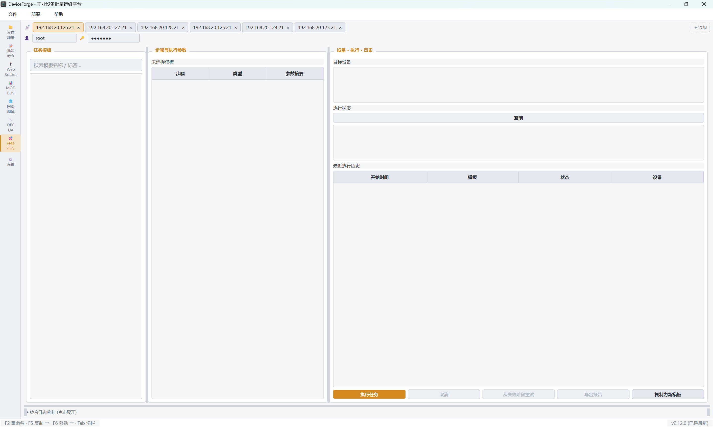
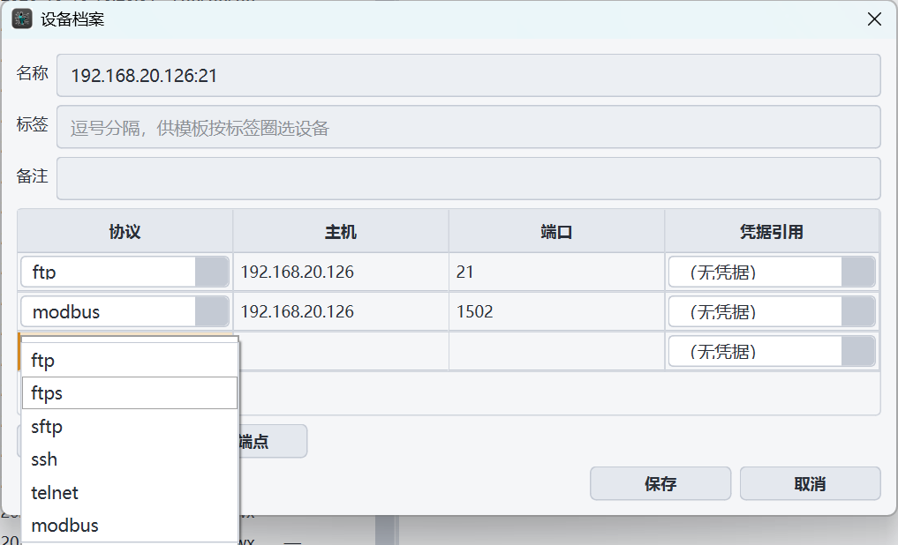
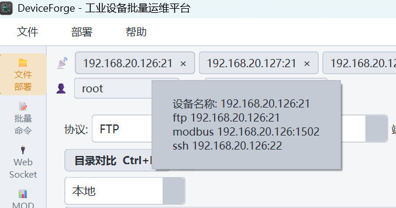

# 从批量操作到任务中心，再到现场工作台：DeviceForge v2.10—v2.12 完整演进

> 上一篇文章写到 v2.9：传输可靠性内核让"上传、下载、批量部署"共享同一套重试、校验与恢复语义。这一篇的三个版本回答的是下一个问题——当现场不再只有一个动作，而是一连串动作时，工具应该长成什么样。

> 修订说明（2026-10-17）：初版「路线图」节曾把「按方向/主题的 WebSocket 事件过滤」记为 v2.13 已立项，与实况不符——该能力实际由 v2.14 立项并已交付，本存档版已就地更正正文。已发布的外部渠道快照无法回改，将在 v2.14 发布说明中统一交代。

**项目**：[turnarond/DeviceForge](https://github.com/turnarond/DeviceForge)

**技术栈**：Qt 6、C++17、CMake、FTP/FTPS、SFTP、Telnet/SSH、Modbus TCP、OPC UA、WebSocket、TCP/UDP 中继

**本文适用**：CSDN、微信公众号、知乎、掘金、GitHub 项目介绍

## 开头：现场运维的三道坎

工业现场的运维任务，很少是"点一下按钮"就结束的。

第一道坎是**联动**：给 PLC 更新一个固件，往往意味着传文件、下发重启命令、等设备回来、再确认服务恢复——四个动作分散在四个界面里，靠人脑串联。

第二道坎是**中断**：二十台设备做到第十三台失败了，已成功的十二台不能重来，第十三台已传了一半的文件不该重传——"从头再来"在工业现场意味着双倍的风险时间窗。

第三道坎是**细活**：任务流跑通了，现场工程师还有一大半时间是花在"看"上的——看设备上的配置文件是不是预期的版本，看远程目录和本地发布目录差在哪，看 PLC 的保持寄存器有没有跳变。看和改的功夫，决定了工具是不是真的"好用"。

DeviceForge 的 v2.10—v2.12 就是沿着这三道坎走的：

```text
v2.10：命令下发闭环——传完文件之后，敢按重启了
  ↓
v2.11：设备任务中心——把一连串动作变成一个可恢复的任务
  ↓
v2.11.1：现场反馈补丁——下拉代替手填、折叠可记忆、列宽可拖动
  ↓
v2.12：三大界面重构——WebSocket、MODBUS、文件管理进入"看和改"的功夫
```

## v2.10：统一命令下发内核，补上"重启闭环"

批量部署完成后，最常见的下一个动作是重启设备让固件生效。但"重启"在工业现场是个微妙操作：命令发出去的瞬间连接就断了，如果按常规语义判定，这会被记为"失败"。

v2.10 做了两件事：

**其一，`BatchCommandRunner` 统一命令下发内核。** Telnet 与 SSH 两条协议链路收敛到同一个执行器：命令序列、超时、重试、取消按同一套语义推进。批量命令页和任务编排用的是同一个内核，不存在"页面上能跑、自动化里行为漂移"。

**其二，部署后重启闭环。** 只对部署成功的设备下发重启命令；重启导致的连接断开被识别为**预期成功**而不是失败；重启参数（协议、命令、超时）持久化，下次打开工具不用重填。

```text
部署 → 成功设备清单 → 下发重启 → 断开=预期成功 → 报告留痕
                ↘ 失败设备：跳过重启，等待重试
```

## v2.11：设备任务中心——把"一串动作"变成"一个任务"

v2.11 是这个项目迄今最大的一次版本：新增了整个任务层，把"文件部署 → 批量命令 → 重启 → 恢复检查"编排成一个可保存、可执行、可恢复、可审计的任务。



### 先有档案：一台设备一份档案，挂多种协议

任务编排的前提是"设备是什么"有唯一答案。v2.11 建立统一设备档案层（`DeviceProfile` / `DeviceRegistry`），核心主张就一句话：**一台设备只登记一次，FTP / FTPS / SFTP / Telnet / SSH / Modbus TCP 六种协议的端点全部挂在同一份档案下**。

```text
设备档案"铸造线 PLC-03"
├── SFTP  :22        ← 文件部署页用它
├── Telnet :23       ← 批量命令页用它（老固件只开 Telnet）
├── SSH   :22        ← 命令与重启用它
└── Modbus TCP :502  ← MODBUS 监控页用它
```

这个设计带来的便利是贯穿性的：

- **一处录入，处处引用。** 文件部署、批量命令、MODBUS、任务中心四个页面引用的是同一份档案，同一台设备的 IP 和口令不用在四个界面各填一遍；凭据只存一份，且进 DPAPI 加密存储，档案层拒绝明文落盘。
- **任务编排因此才成立。** 四阶段步骤（文件部署 → 批量命令 → 重启 → 恢复检查）在同一条任务里切换协议：部署步骤走这台设备的 SFTP 端点，命令和重启步骤走它的 SSH 或 Telnet 端点——步骤之间不需要你告诉引擎"这是同一台机器"，档案本身就是答案。
- **设备总线一眼看清全貌。** 胶囊按名称显示，悬浮列出该设备挂的全部端点与协议，双击直接编辑档案；含 Modbus 端点即代表"这台设备启用 MODBUS 监控"（v2.12 的目标身份也统一到了档案上）。
- **零迁移成本。** 旧版按协议各管各的设备列表，打开新版本自动兼容迁移成档案，不用重建。





### 模板：把重复劳动固化成资产

`TaskTemplateStore` 支持版本化任务模板。现场调好一次"升级固件并验证服务"的流程，存成模板，下一批设备直接复用。模板**拒绝任何凭据入库**——凭据永远留在设备档案和 DPAPI 加密存储里，模板只引用。

### 阶段恢复：失败后从断点继续，而不是从头再来

执行引擎（`TaskExecutionEngine`）设备间串行、步骤严格按四阶段推进。最关键的设计是 `retryFailed` 阶段恢复：

```text
首次执行：设备A [✔部署 12/12 文件] [✔命令] [✘重启超时]
重试执行：设备A [跳过已交付文件] [从命令阶段继续]
```

已交付的文件不重传、已成功的设备不重跑——重试的语义是"继续"，不是"再来"。重启后设备断开按预期成功处理，这条 v2.10 的语义在任务层继续生效。

### 记录与脱敏：每一次执行都可审计

`TaskRunStore` 三级记录（任务 → 设备 → 步骤），设备名称与地址在任务开始瞬间定格为**不可变快照**——事后改档案不影响历史记录的真实性。查询支持按模板/设备/结果筛选，保留策略自动清理旧记录且不碰运行中的任务。所有错误文本落库前统一过脱敏，日志里不会出现密码和敏感内容。

风险确认默认拒绝：勾选"部署后重启"这类高危步骤，不点确认就不会执行。

### v2.11.1：来自现场的三条反馈

发布后现场同事提了三条很具体的问题：添加设备要手填协议字符串（填错一个字母任务校验就失败）、凭据引用要先去别处建好再回来粘贴键名、综合日志折叠后找不到展开入口。v2.11.1 全部按"正常人期待"修掉：协议改下拉、凭据就地新建（DPAPI 加密）、折叠条常驻可点、批量命令结果表列宽可拖动。

## v2.12：三大界面重构——"看和改"的功夫

任务流跑通之后，v2.12 把三块使用频率最高、但还停留在"能用"阶段的界面重做了一遍。

### WebSocket：从收发框到双栏控制台

旧版 WebSocket 页是一个表单加一个输出框。重构后是双栏控制台：上部连接与操作区（Server/Client、WSS、Token），下部实时事件流表格——方向、对端、主题、字节数、内容预览逐条呈现，2000 行环形缓冲，UTF-8 截断安全。

工程上值得说的是两点：事件模型抽成 `WsEventTypes` 纯逻辑头文件，解析/编码/字节口径全部可单测；Token 凭证迁入 DPAPI 加密存储，写路径顺手清扫历史明文行。评审还揪出一个真 UAF——错误路径上客户端连接未释放，析构后回调悬空，修复后补了本机 Server↔Client 环回测试锁住行为。

### MODBUS：为"多 PLC 主看偶写"重新设计形态

现场的真实用法是：连着多台 PLC，99% 的时间在看寄存器，偶尔改一个点。旧版"批量读写测试"的表单形态和这个工作流完全对不上。

v2.12 的 MODBUS 页按监控台重做：

- **身份统一**：设备档案含 Modbus 端点即代表"这台设备启用 Modbus"，从站与轮询参数独立成目标档案，旧配置一次性自动迁移；
- **调度器**：单驱动 250ms tick + 到期时间推进，每连接 FIFO 队列、写命令插队首、断链指数退避（1s→30s 封顶）——IO 留在 GUI 线程，靠 Qt Modbus 异步 API 消化 5～20 台、500ms～2s 刷新的规模，不引入工作线程的复杂度；
- **呈现**：双栏目标清单 + 逐寄存器视图，变化高亮、被跳过轮询计数、退避状态着色。

测试上最有意思的是环回方案：用 `QModbusTcpServer` 在 CI 里起本机 PLC，甚至构造"假 PLC 顶掉真连接"的场景复现了在途请求错配——这类 bug 在真设备上可能要几周才撞见一次。

### 文件管理：元数据列、目录对比、F4 在线编辑

FTP/SFTP 双栏面板（左本地右远程）是工程师盯得最久的界面，v2.12 给它补了三样东西：

**元数据列。** 所有者、修改时间、权限直接显示。底层其实一直拿得到这些数据——FTP LIST 的 user 列、SFTP 的 uid——只是过去被解析器丢掉了，这次是"捡回来"。创建时间？FTP 和 SFTP 协议都给不了，所以没有这一列，取不到的单元格一律 `—`。

**目录对比（Ctrl+M）。** 左右目录按元数据口径分类：同名比大小、大小相同再比分钟级时间；差异行琴色着色、单侧独有的行对面插占位行对齐、可勾选"仅显示差异"，底部汇总条给出四类计数。对比只读，任一侧刷新自动退出，不会拿旧快照误导。

**F4 在线预览编辑。** 选中远程文件按 F4，直接打开内置编辑器：编码自动探测（UTF-8/GBK/UTF-16 BOM，下拉可手动切换重解码），改完"保存并上传"回传原路径。上传前会重新拉取远端目录做冲突检查——如果你打开文件这段时间里远端被别的工具改过，会弹出"仍要覆盖 / 放弃并刷新"而不是默默覆盖。超过 2MB、二进制、行尾混用的文件一律只读横幅提示，宁可不做也不做错。

工程细节：网络 IO 全程非阻塞是硬约束——读写走 libcurl/libssh2 内存原语（不落临时文件），QtConcurrent worker + 代际令牌守卫，切目录、断连、重连后的过期回调一律丢弃。GBK 编解码走 Win32 代码页 API（项目不引入 Qt5Compat）。代码评审阶段还修掉一个典型竞态：慢链路上连开两个文件，旧回调晚到会把"甲的内容+乙的路径"装进编辑器——保存即误覆盖。修复是"打开即推进代际、路径与内容作为值对绑定回传"，并配了乱序回调回归测试。

## 工程侧：三个版本是怎么稳住的

**异步纪律。** 所有网络操作统一"QtConcurrent worker + QPointer 守卫 + 代际令牌"三件套：回调先验代际再动界面，导航/刷新/换源都会作废在途请求。这个模式从 v2.7 的目录加载开始，现在覆盖了传输、编辑器、重连重试的全部路径。

**设计纪律："琴色是动词"。** 界面主色 #F0A030 只出现在信号态——选中、焦点、活跃页、差异行、主按钮；静止的结构一律石墨灰。深色/亮色双主题成对维护，目录对比的行色按主题各一组常量。

**评审作为流程。** v2.12 的三个功能线各自经历了"实现 → 子代理代码评审 → 修复波 → 复审"。评审产出的不只有修复清单（WebSocket 的 UAF、MODBUS 的编辑弹窗缺失、文件管理的串包竞态），还有对规格文档的勘误回写——文档与代码以同一棵树对外。

**测试基线。** 从 v2.9 的 30 个目标到 v2.12 的 45 个：协议环回（Modbus/WebSocket/SFTP）、异步竞态（面板加载/编辑器乱序回调）、纯逻辑（调度器假时钟、编码探测真实字节序列、目录对比口径）分层覆盖。发版前固定动作：全量 CTest 两轮 + UI 冒烟脚本 + 九源版本一致性校验。

## 快速上手

- 下载预编译包：GitHub Releases 的 `DeviceForge-vX.Y.Z-win64.zip`，解压即用（自带 Qt 运行时与协议库）；
- 从旧版本 OTA 升级：工具内"检查更新"直接热替换；
- 源码构建：`build.bat` 一键（CMake + VS2022 + Qt 6.11），测试 `cd build && ctest -C Release`。

## 路线图

当时立项的方向：Modbus 命名点位（tag）体系、远程文件 hex 预览、目录对比递归模式与同步向导；按方向/主题的 WebSocket 事件过滤已由 v2.14 立项并交付（2026-10-17 修订，详见文首修订说明）。跨平台 GUI（Linux）与插件化加载仍在中期规划。

---

**项目地址**：[turnarond/DeviceForge](https://github.com/turnarond/DeviceForge)

**建议标签**：`Qt` `C++17` `工业软件` `设备运维` `PLC` `Modbus` `任务编排` `FTP` `SFTP` `嵌入式`

---

## 平台发布建议

### CSDN

标题：`从批量操作到任务中心，再到现场工作台：DeviceForge v2.10—v2.12 完整演进`

摘要：本文回顾 DeviceForge v2.10—v2.12 的版本演进：统一命令下发与重启闭环、设备任务中心（档案/模板/阶段恢复/审计记录），以及 WebSocket、MODBUS、文件管理三大界面重构——看工业运维工具如何从"能执行"走向"可恢复、可审计、可细看"。

### 微信公众号

标题：`三个版本，DeviceForge 把"一串动作"变成了"一个任务"`

导语：传文件、发命令、重启、验证——当这些动作分散在四个界面里，风险藏在人脑的串联里。DeviceForge v2.10—v2.12 用三个版本，把它们编排成可保存、可恢复、可审计的任务，并把"看和改"的功夫补进了三大界面。

### 知乎

标题：`工业设备运维工具做到什么程度，工程师才敢把批量重启交给它？`

建议从"重启断连算成功还是失败"这个具体判定切入，展开预期成功语义、阶段恢复和不可变审计记录，再带出三大界面重构，避免功能罗列。

### 掘金

标题：`代际令牌、写插队与 250ms 单驱动 tick：DeviceForge v2.12 的三堂工程课`

建议重点讨论编辑器异步竞态（串包 bug 与修复）、Modbus 调度器的规模假设驱动选型、编码探测不用 QTextCodec 的 Win32 代码页实现，适合技术读者深入阅读。

### 发布前检查

- 替换 Release 下载链接为 v2.12.0 实际地址（已发布）；
- 截图使用 README 最新五图（双栏对比、在线编辑、MODBUS 双栏、WebSocket 控制台）；其中 MODBUS 为真实现场调试界面，含内网测试 IP 与默认账号，已确认不涉密、可直接对外；其余截图为演示数据。本文新增的三张档案/任务中心图同为现场环境截图（同一内网 IP 段），口径同上；
- 各平台正文保留 GitHub 项目链接；
- 配图已就位：「先有档案」节插入 设备档案编辑.png（协议下拉六种可选）与 设备总线悬浮.png（一台设备 ftp/modbus/ssh 三端点），v2.11 节首插入 任务中心.png（三栏页）；发布到不支持相对路径的平台（CSDN/公众号/知乎/掘金）时上传这三图并替换为图床地址；
- 不宣传尚未交付的 SCP、跨平台 GUI、插件化、命名点位能力；
- 首发后观察阅读、收藏、GitHub 跳转与 Issue 反馈，再调整平台版本。
