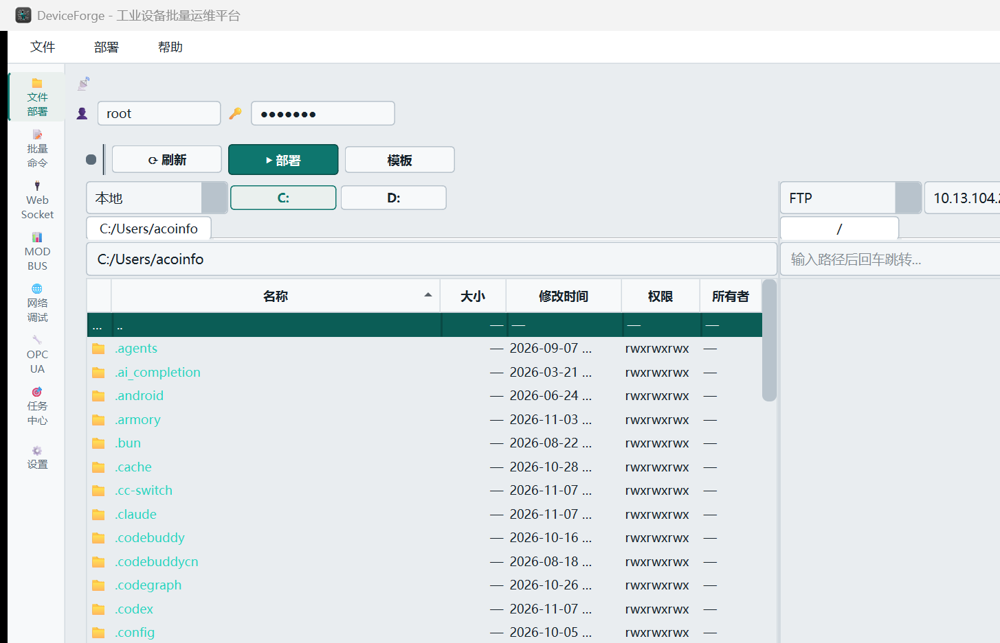
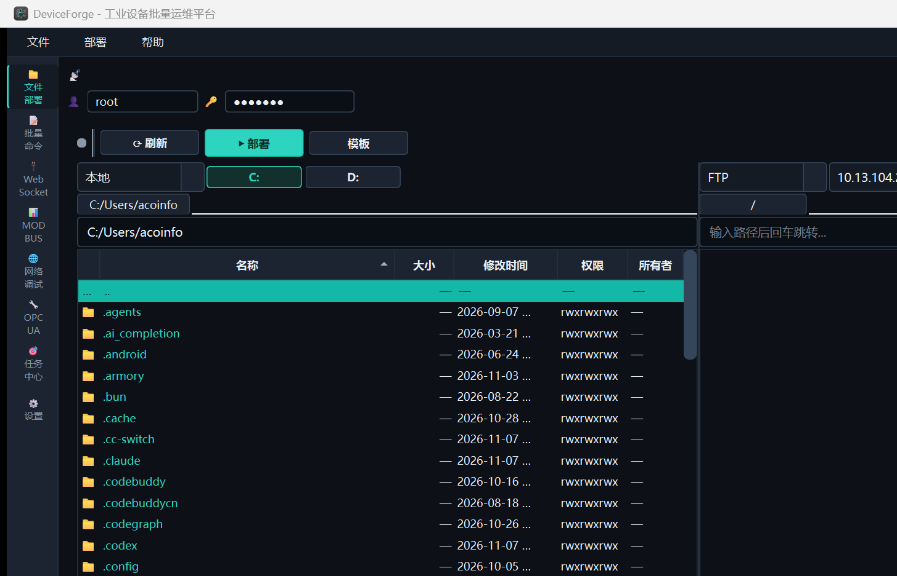

# DeviceForge v2.17.0 发布：把"能用的界面"重新做成了"想用的界面"

> 发布日期：2026-11-07 · 版本：v2.17.0 · 平台：Windows x64 · 许可：MIT

## 四平台标题与摘要

| 平台 | 标题 | 摘要 |
|---|---|---|
| CSDN | `DeviceForge v2.17 发布：工业工具界面重构 + 文件管理全面 TC 化` | 一个 Qt6 工业运维工具怎样从"能用"走向"想用"：Instrument 双主题、Total Commander 式文件管理、色值单源与静态守卫的工程实践。 |
| 知乎 | `不换工具，换手感：我们把工业运维平台的界面重做了一遍` | 视觉语言重构 + TC 化交互的完整复盘：为什么放弃"琴色"、为什么把连接参数从工具栏拿掉、为什么选中态要用实底反色。 |
| 掘金 | `Qt6 桌面应用 UI 重构实践：双主题 Instrument + TC 式文件管理` | 从 QSS 重写到 ThemeTokens 色值单源、theme_guard 静态守卫，再到多标签/快捷键/目录递归复制的落地细节。 |
| 微信公众号 | `好用的工具，界面先说话：DeviceForge v2.17 发布` | 工业设备批量运维平台的一次"面子+里子"升级：更冷静的配色、更顺手的文件管理、更克制的信息密度。 |

---

## 一、为什么要重做界面

DeviceForge 是一个"工程现场工具"：批量部署文件到几十台嵌入式设备、批量下发命令、调 Modbus/OPC UA/WebSocket。它一直在**功能**上够用，但界面始终是"能用"而非"想用"——

- 双主题里亮色像一张白纸，层次全靠灰阶硬撑；
- 深色主题的强调色（琴色）被用在了太多地方，导致"信号"和"结构"分不清；
- 文件管理区顶部堆了三行工具栏（连接参数 / 部署选项 / 结果操作），1366 宽的笔记本上右侧按钮直接被裁；
- 文件列表选中行是浅色淡底，一眼看不出选没选中。

v2.17 的目标很明确：**不改变工具能力，把操作手感重构到"工程师愿意天天用"**。

## 二、视觉：Instrument 精密仪器






### 2.1 配色哲学：青色是动词

旧体系叫"琴色是动词"——强调色（琴色/琥珀）只用于"此刻可动作"的状态。v2.17 把这条原则继承下来，并把颜色换成了更冷静的信号色：

| 角色 | 亮色 | 深色 |
|---|---|---|
| 画布 | `#E9EDF0` 冷灰 | `#0D1117` 炭黑 |
| 面板 | `#FFFFFF` 纯白 | `#141B24` |
| 信号色（accent） | `#0E766E` 深青 | `#2DD4BF` 亮青 |
| 主文字 | `#16222B` | `#E6EDF3` |
| 结构边框 | `#D3DAE0` | `#263140` |

**accent 只出现在七种"动词态"**：主按钮填充、输入焦点 2px 边框、选中行、活跃 tab、选中行左侧竖条、分组标题竖条、进度条。其余一切（容器、输入框、下拉、表头、分隔条）全部中性色——眼睛只需在"能点/不能点"上做判断，不必在"颜色是什么意思"上消耗注意力。

### 2.2 色值单源 + 静态守卫

QSS 管不到的地方（代码里动态设置的状态点、任务三态、进度终态、目录名、对比色板、退避色、OPC UA 类色块、链接色）过去散落着 45 处色值字面量。v2.17 引入：

```cpp
// src/app/ThemeTokens.h
enum class Token { Canvas, Panel, Elevated, Input, Border, BorderStrong,
                   Text, TextMuted, TextDim, Accent, AccentHover, AccentPressed,
                   AccentInk, Success, Danger, Warning, /* 末位约束 */ };
QColor color(Token token, bool dark);
```

配套 `tools/devtools/theme_guard.py`：扫 `src/` 全文（含 SVG 里的 `%23` 编码色值），命中旧色板即失败，退出码 0/1/2/3 语义化。改主题不再靠人眼 grep。

### 2.3 选中态：实底反色

文件表格的选中行原来用 `#EAF0EE` 浅青底 + 深青字——对比度勉强，而且**选中时文字颜色会被模型的 ForegroundRole（目录名青色）覆盖**，看起来像"没选中"。修复分两层：

1. QSS 把选中行改成信号色**实底**：亮色 `#0E766E` 深青底白字、深色 `#2DD4BF` 亮青底深墨字；失焦用深一档保持可辨；`:hover` 只作用于未选中行（否则浅 hover 底会冲淡选中行）。
2. 模型对选中行返回反色前景（`setSelectedRows` + `dataChanged`），让选中行的目录名也是反色，不再被 accent 青盖掉。

另外"进入目录默认选中首行（`..`）"——不是炫技，是让键盘导航（Enter/方向键/打字即定位）开箱即用。

## 三、文件管理：全面 TC 化

参考对象是 Total Commander——工程师群体里最"肌肉记忆"的双栏文件管理器。这一版把它的核心习惯逐条搬进来。

### 3.1 上部做减法

原来顶部三行工具栏（协议/设备/端口/FTPS + 清空/重启四参 + 刷新/部署/报告/重试）。现在：

```
[● 状态点] [⟳ 刷新] [▶ 部署] [模板] [⬇ 报告] [↻ 重试] [⚙]   ← 单行操作栏
```

- **连接参数收编**：协议/端口改由"右栏源选择器 + 设备档案"驱动（控件保留在内部、界面隐藏），不再占主界面；
- **部署选项折叠**：部署前清空远程、部署后重启四参、目录对比收进「⚙」面板，默认收起；
- 部署按钮统一「▶ 部署」，台数/空选中提示进 tooltip（行为不变：空选中仍拒绝）。

### 3.2 驱动器按钮条

```
[源 本地 ▾] [C:] [D:]          ← 与下拉同级（TC 布局）
[C:/Users/acoinfo]             ← 路径栏
[文件表格]
```

点按钮直达盘根、当前盘高亮、悬浮显示「可用/总计」。顺带修了一个真 bug：双击驱动器行时按"当前路径+子名"拼出无效的 `/C:/`（驱动器双击进不去的根因）——改为识别 `X:` 绝对路径直接导航。

### 3.3 多标签

每栏标签栏位于驱动器行下方、路径栏上方（TC 位置）：单击切换、**双击标签关闭**、**双击空白新增**、Ctrl+T/Ctrl+W；标签显示完整路径并随导航更新。先前的实现放在源选择器上方且只能显示末段名——"太敷衍"，推翻重做。

### 3.4 键盘肌肉记忆

`F2` 重命名 / `F3` 查看 / `F4` 编辑 / `F5` 复制到对面 / `F6` 移动到对面 / `F7` 新建文件夹 / `F8` 删除 / `Delete` 删除 / `Tab` 切栏 / `Enter` 进入 / `Backspace` 上级。

### 3.5 打字即定位

表格聚焦时直接敲字符 → 按名称前缀选中首个匹配（1.2s 无输入自动清空，面包屑显示「定位: xxx」）。TC 用户最熟悉的那一下，不用先点搜索框。

### 3.6 目录递归复制

拖拽/F5/F6 对**文件夹**也生效：本地→远程递归上传、远程→本地递归下载（本地自动建子目录）、本地↔本地直接递归复制。远程↔远程仍按既有口径提示暂不支持。

### 3.7 其他

- 列头排序（点击升降序、目录恒在前）；
- 路径历史补全（输入时下拉候选，上限 20 条，ConfigStore 持久化）；
- 中文文件名：本地源改用 `u8string` 承载（Windows `std::filesystem` 的 `.string()` 是 GBK，Qt 按 UTF-8 读会乱码）；
- 综合日志区默认折叠（状态版本迁移：旧记录不采信"展开"值）。

## 四、工程侧：这版留下了什么

- `ThemeTokens.h`：17 个 token × 双主题的**单源真值**，测试 `tst_theme_tokens` 逐值断言；
- `theme_guard.py`：静态守卫，旧色值残留即红（进 CI 可挂）；
- 测试基线 54 个 CTest 目标（新增主题 token 目标）；本机全量 53/54，唯一失败是环境冲突（VS Code 占用 OPC UA 环回端口）；
- 九源版本一致性校验（CMake/rc/README/CHANGELOG/CLAUDE/白皮书/ReleaseNotes/ROADMAP/产品路线图）全绿。

## 五、升级须知

- ⚠ **连接参数位置变了**：协议/端口改在右栏源选择器选；
- ⚠ **部署按钮文案变了**：统一「▶ 部署」，台数看 tooltip（空选中仍拒绝）；
- ⚠ **本地源默认进用户目录**：盘符切换用驱动器按钮条；
- ⚠ **日志默认折叠**：旧"展开"记录不再采信。

无数据迁移，覆盖安装即可。

---

**项目地址**：github.com/turnarond/DeviceForge

如果这篇复盘对你有帮助，欢迎 Star；也欢迎在评论区聊聊你用过的"顺手到有肌肉记忆"的桌面工具——下个版本我们继续把 TC 的剩余习惯（路径栏历史下拉、扩展名列、批量重命名）搬完。
